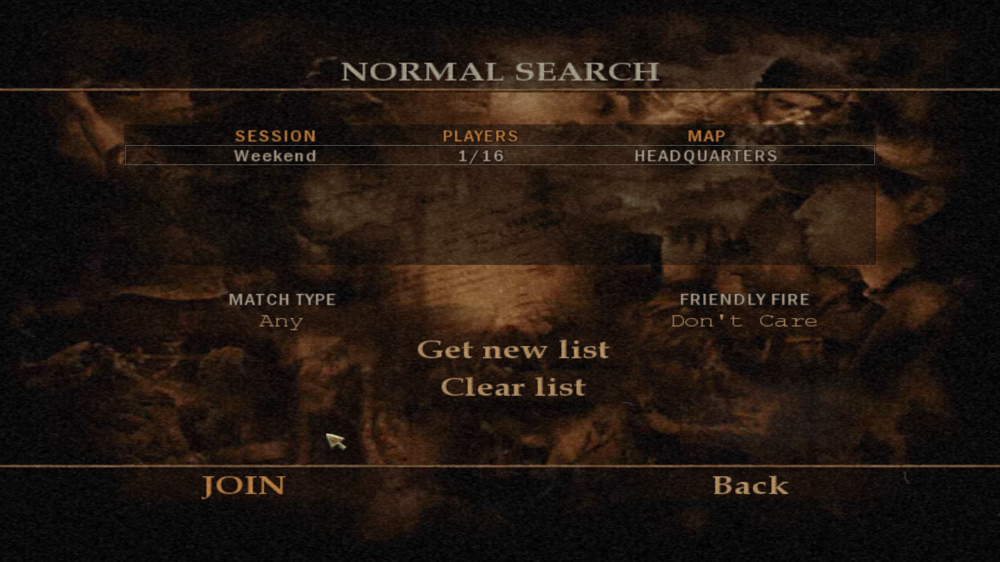
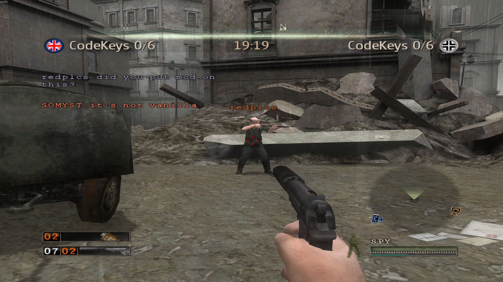
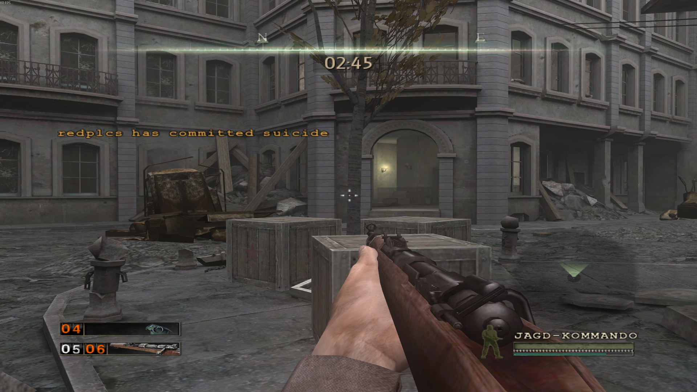
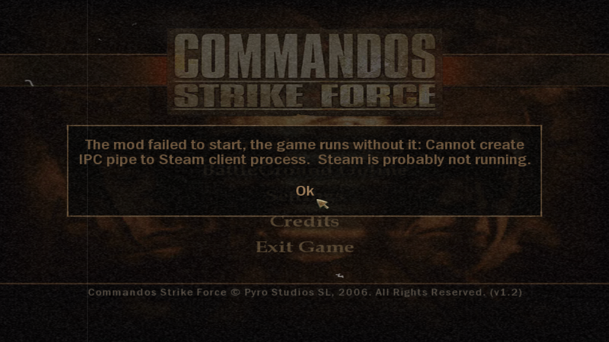

# Gestapo.SteamNetworking

[](https://github.com/redplcs/gestapo-steamnetworking/releases/latest)
[](https://github.com/redplcs/gestapo-steamnetworking/releases)

Play Commandos: Strike Force with your Steam friends over the internet, using the game's regular LAN mode. No Hamachi, VPN or port forwarding needed.

<p></p>

## You need

- The mod installed and Steam running, for everyone in the match
- All players to be friends on Steam
- Identical `Juego.cfg`, `JuegoPla.cfg`, `Red.cfg` and `MultiP.cfg` in the game's `Config` folder, because the game hides LAN matches when these files differ

## Install

1. Download the archive from the [latest release](https://github.com/redplcs/gestapo-steamnetworking/releases/latest).
2. Copy `dinput8.dll` and `steam_api.dll` into the game folder, next to `CommXPC.exe`.
3. Start Steam, then start the game.

To uninstall, delete both files.

## Play

The host creates a LAN match as usual, and everyone else joins from the LAN list. If a match is missing, wait a few seconds and open the list again.

## Good to know

- Steam shows you as playing Spacewar, because the mod uses Steam's test App ID 480.
- Friends can't see a match hosted while you're Invisible on Steam, so stay visible when hosting.
- Only your Steam friends can connect to you.
- While the mod is active, the game's traffic goes only through Steam, so players on your real LAN need the mod too.
- It can't be installed alongside another mod that also uses the file name `dinput8.dll`.
- The mod is made for one build of `CommXPC.exe`. On another build it stays off and says so in its log.

## Problems?

When the mod hits an error, it shows it in the game. Open an [issue](https://github.com/redplcs/gestapo-steamnetworking/issues) and attach the newest `steamnet-*.log` from the game folder. Issues are public and the log contains Steam names and IDs, so remove anything you don't want to share.

## How it works

The game loads the mod as its `dinput8.dll`, and the mod passes DirectInput on to the real one from System32. It hooks the game's Winsock imports, so the LAN code runs on a virtual network: every player gets a `10.x.y.z` address made from their Steam account ID, and packets go over Steam's relay network (SteamNetworkingMessages) to friends whose rich presence says they run the mod.

## Building

You need:

- the .NET 10 SDK;
- the MSVC linker, which NativeAOT uses to link the DLL: install [Build Tools for Visual Studio](https://visualstudio.microsoft.com/downloads/#build-tools-for-visual-studio-2026) with the "Desktop development with C++" workload. A full Visual Studio with that workload works too.

The build runs from the command line, so any editor will do:

```
dotnet publish src -c Release
```

The output is in `src\bin\Release\net10.0-windows10.0.17763.0\win-x86\publish\`. Rename `Gestapo.SteamNetworking.dll` to `dinput8.dll` and copy it to the game folder together with `steam_api.dll`.

### Two copies on one PC

Set `GESTAPO_TRANSPORT=loopback` in a terminal and start every copy from that terminal. The copies then talk over UDP on 127.0.0.1 instead of Steam: up to 8 copies, copy N gets `10.0.0.N`. A copy started from Explorer doesn't see the variable and runs on Steam.

## License

[MIT](LICENSE)
